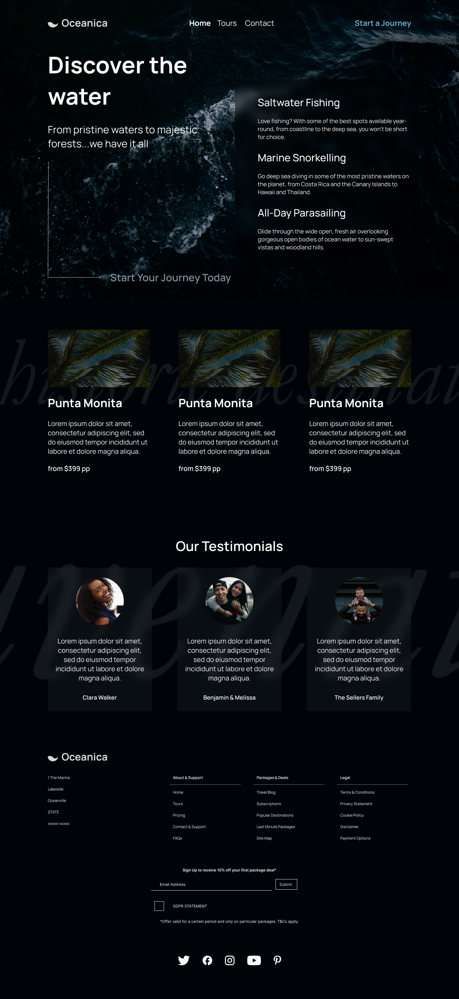
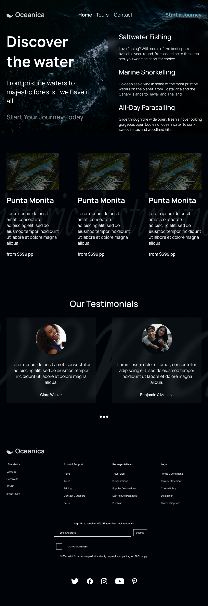
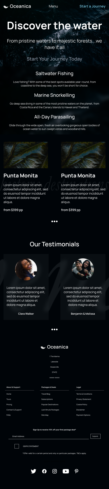

# 🌊 WaveUI

A modern responsive frontend project built with **Tailwind CSS v4**, focused on converting a real-world Figma design into a pixel-perfect and fully responsive web experience.

This project demonstrates my ability to translate UI/UX designs into clean, scalable, and production-ready frontend code.

---

## 🎨 Design

🔗 Figma Design  
https://www.figma.com/design/ZU81y6D1wp6ZKRBDpM0m58/-Discover-The-Water---Oceanica--Responsive-Live-Website---DesignCourse--Community--?node-id=0-1&p=f&t=enLWfLXJjUw8i1bP-0

---

## 🚀 Live Demo

🟡 Coming soon  
🔗 https://00mohammad.github.io/WaveUI/

---

## 📱 Responsive Design

| Device                  | Preview                                                              |
| ----------------------- | -------------------------------------------------------------------- |
| 🖥 Desktop (1440px+)    |                 |
| 💻 Tablet (1024px)      |                   |
| 📟 Small Tablet (744px) |  |
| 📱 Mobile (375px)       |                    |

---

## 🛠 Tech Stack

- HTML5
- CSS3
- Tailwind CSS v4
- JavaScript (Vanilla)
- npm
- Tailwind CLI

---

## ✨ Key Highlights

- Pixel-perfect implementation from Figma design
- Fully responsive mobile-first layout
- Clean and scalable Tailwind architecture
- Real-world frontend development workflow

---

## 📚 What I Learned

- Converting UI designs into functional code
- Building responsive layouts across breakpoints
- Improving Tailwind CSS workflow efficiency
- Structuring maintainable frontend projects
- Translating design systems into code

---

## 🚧 Roadmap

- Deploy live demo (GitHub Pages / Vercel)
- Add animations and micro-interactions
- Convert into reusable UI components
- Improve performance optimization
- Add dark mode support

---

## 👨‍💻 About

Frontend Developer focused on building modern, responsive, and user-friendly web interfaces.

🔗 GitHub: https://github.com/00mohammad
